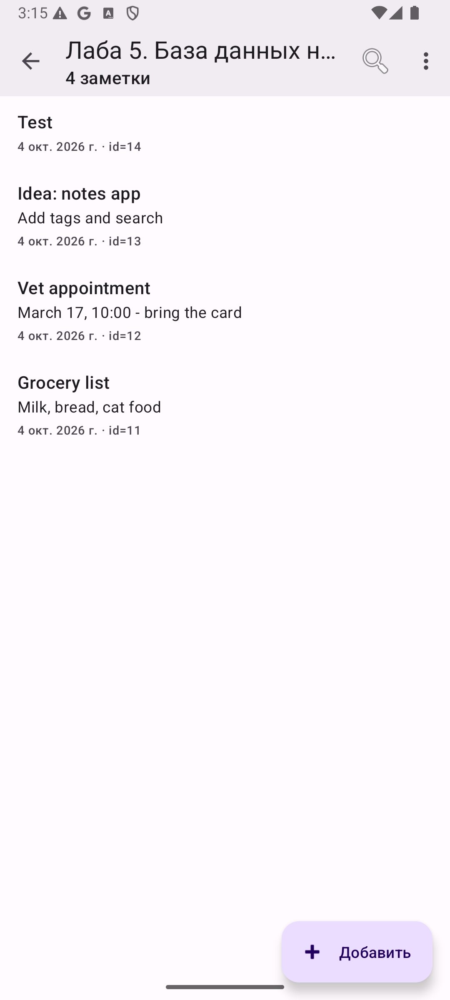
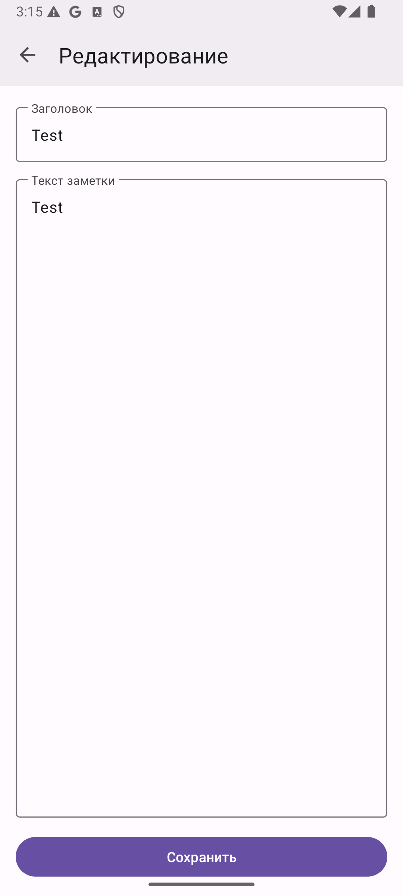
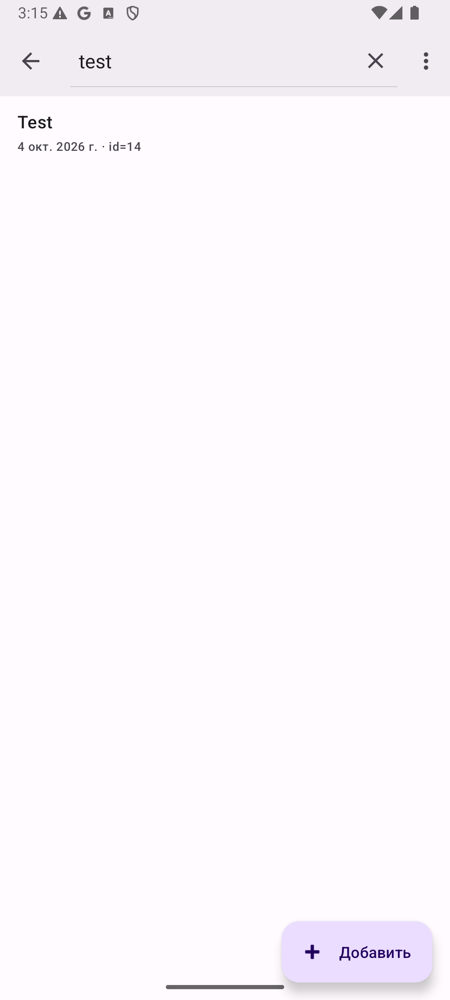
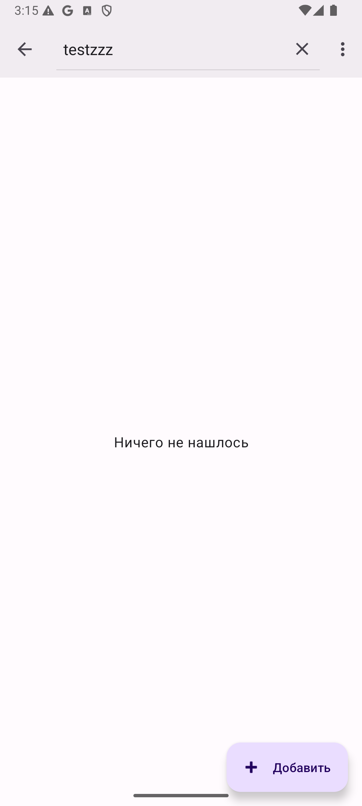
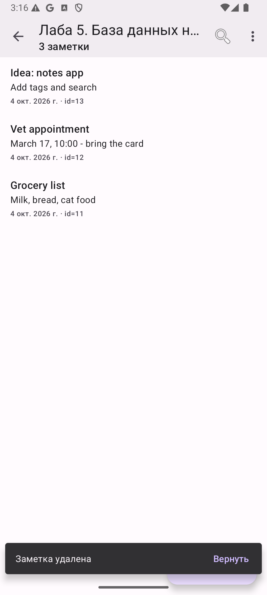
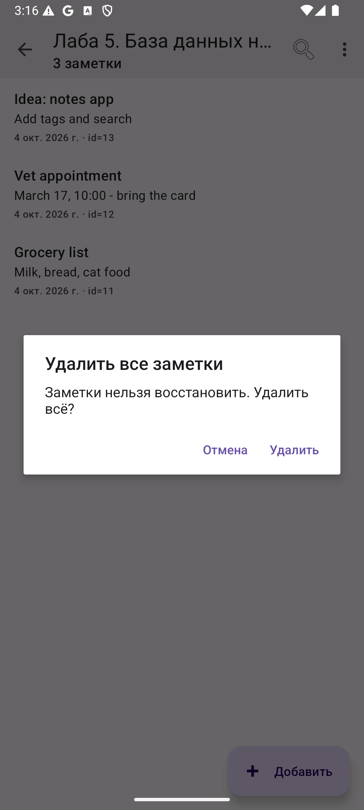
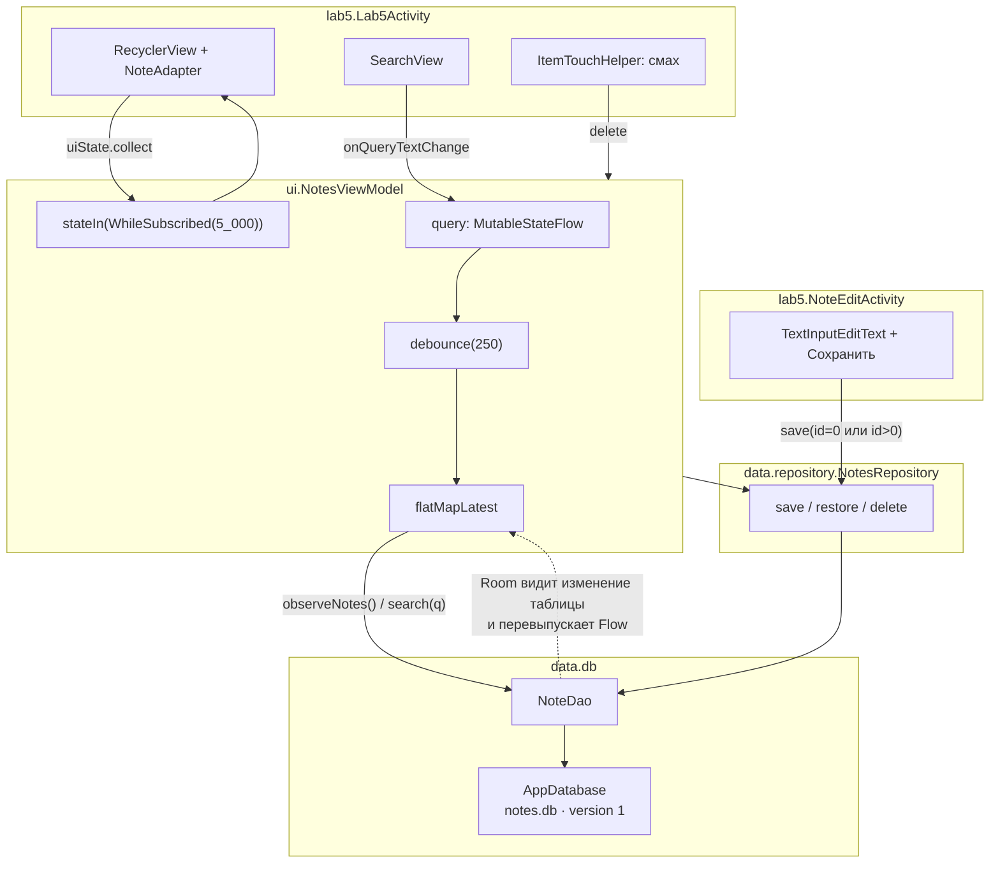

# Лабораторная 5. Room, DAO, Flow: заметки

> **Сложность:** средняя · **Время:** 3–4 часа · **Тег:** `lab5-v1.0`
> **Итог:** список заметок в `Room`, который сам обновляется при любом изменении
> таблицы — из этой же Activity, из экрана редактирования или из восстановления
> удалённого смахом.


> 🎬 [WebM-версия демо](assets/lab5-demo.webm) — то же самое, но меньше размером и лучше качеством.

---

## 🎯 Цель работы

> Разобраться, чем Room отличается от «просто взять `SQLiteDatabase`», научиться
> описывать таблицу аннотациями, отдавать данные не списком, а `Flow`, и
> строить `ViewModel`, который не перезапрашивает базу вручную.

| | | 
|---|---|
| **Что делаем** | Экран «База данных на Room»: список заметок, создание и редактирование, поиск с паузой, удаление смахом с отменой, удаление всех | 
| **Чему учимся** | `@Entity` / `@Dao` / `@Database`, `suspend` против `Flow`, `flatMapLatest` и `debounce`, `stateIn(WhileSubscribed)`, миграции и `exportSchema` | 
| **Итоговый навык** | Понимать, почему список не нужно «обновлять вручную», и видеть, где именно в цепочке `DAO → Flow → ViewModel → Activity` происходит лишний запрос |

## 📚 Что изучим

- `@Entity`: таблица, `@PrimaryKey(autoGenerate = true)`, `@ColumnInfo`, `@Index`
- Почему `id` — `Long`, а не `Int`
- Два времени: `createdAt` и `updatedAt`, и почему это разные поля
- `@Dao`: `@Query`, `@Insert`, `@Update`, `@Delete` и что каждый из них возвращает
- `suspend fun` в DAO против `fun … : Flow` — разница не в асинхронности, а в подписке
- `Flow` от Room: база сама сообщает, что таблица изменилась
- `flatMapLatest`: отмена предыдущего запроса, а не запуск десятого
- `debounce`: не делать запрос на каждый символ
- `stateIn(WhileSubscribed(5_000))` и зачем нужна задержка в 5 секунд
- `exportSchema = true` и файл `schemas/…/1.json` как проверка миграции
- Почему `fallbackToDestructiveMigration` — это временно

---

## 🖼️ Что получится


> 🎬 [WebM-версия демо](assets/lab5-demo.webm) — то же самое, но меньше размером и лучше качеством.

| Экран | Скриншот |
|-------|----------|
| Список заметок |  |
| Редактор заметки |  |
| Поиск |  |
| Поиск без результатов |  |
| Удаление смахом |  |
| Подтверждение удаления всех |  |
| Пустое состояние |  |

---

## 🧠 Архитектура



Ключевая стрелка — пунктирная: список не знает, кто изменил таблицу. Экран
редактирования записывает заметку и закрывается; список обновляется сам, потому
что подписан на `Flow` из DAO.

---

## 🧠 Теория

### 5.1 Room против «просто `SQLiteDatabase`»

Голый SQLite на Android — это `SQLiteOpenHelper`, `ContentValues`, ручной
`Cursor` и `cursor.close()`. Формально всё то же самое, но ошибка в строке
запроса выясняется только в момент запуска на устройстве, а забытый
`cursor.close()` — это утечка, которая проявится через полгода.

Room делает три вещи:

1. **Проверяет SQL во время сборки.** KSP-процессор запускает каждый `@Query`
   на временной базе SQLite. Опечатка в `SELECT` — это ошибка компиляции, а не
   краш у пользователя.
2. **Проверяет, что `@Query` возвращает то, что объявлено.** Запрос
   `SELECT * FROM notes`, который возвращает `Note`, будет приведён к нужному
   типу автоматически. Запрос с лишним столбцом — ошибка сборки.
3. **Отдаёт `Flow`.** Это то, ради чего Room и подключают: база знает, когда
   таблица изменилась, и перевыпускает значение подписки.

Цена — кодогенерация и ещё один плагин в сборке.

### 5.2 `@Entity`: таблица в виде класса

```kotlin
@Entity(
    tableName = "notes",
    indices = [Index("updatedAt")],
)
data class Note(
    @PrimaryKey(autoGenerate = true)
    val id: Long = 0L,

    @ColumnInfo(name = "title")
    val title: String,

    @ColumnInfo(name = "body")
    val body: String = "",

    @ColumnInfo(name = "createdAt")
    val createdAt: Long,

    @ColumnInfo(name = "updatedAt")
    val updatedAt: Long,
)
```

Три решения, которые стоит увидеть сразу:

- **`autoGenerate = true`.** `id` назначает сама база, поэтому при создании
  можно оставить `id = 0L` и получить настоящий `Long` обратно из `@Insert`.
- **`Long`, а не `Int`.** Счётчик SQLite длинный, `Int` переполнится на
  2 147 483 647-й записи.
- **Индекс по `updatedAt`.** Список всегда сортируется по нему, а без индекса
  каждая выдача — full scan таблицы.

`@ColumnInfo` в этом коде избыточен: имя поля совпадает с именем столбца. Он
оставлен намеренно — в реальных проектах поле `createdAt` в Kotlin спокойно
становится `created_at` в SQL, и без аннотации пришлось бы писать
`@ColumnInfo(name = "created_at")` всем подряд.

### 5.3 Два времени: `createdAt` и `updatedAt`

Момент создания не меняется **никогда**, момент последнего изменения меняется при
каждом сохранении. Одно поле «дата» не может ответить на оба вопроса: если
заменить его на `updatedAt`, заметка, отсортированная по дате создания,
начнёт прыгать вверх при каждом редактировании.

### 5.4 `@Dao`: `suspend` против `Flow`

```kotlin
@Query("SELECT * FROM notes ORDER BY updatedAt DESC")
fun observeAll(): Flow<List<Note>>

@Insert
suspend fun insert(note: Note): Long
```

Разница не в том, что один «быстрее», а в контракте:

| | Один раз или подписка | Что произойдёт, если данные изменятся |
|---|---|---|
| `suspend fun getAll(): List<Note>` | один раз | список устареет, обновлять вручную |
| `fun observeAll(): Flow<List<Note>>` | подписка | Room перевыпустит новое значение сам |

`suspend` в методах DAO не декоративен: Room сам переносит их на свой
`queryExecutor`, поэтому оборачивать вызов в `withContext(Dispatchers.IO)` не
нужно. Обёртка — типичный признак того, что человек не понял, где уже
переключение произошло.

### 5.5 `LIKE` и параметр запроса

```kotlin
@Query("SELECT * FROM notes WHERE title LIKE '%' || :query || '%'")
fun search(query: String): Flow<List<Note>>
```

`?` в SQL заменяет аргумент **целиком**. Наивное `LIKE '%?%'` ищет буквальный
знак вопроса, а не содержимое параметра. Конкатенация `'%' || :query || '%'` —
способ склеить шаблон с аргументом внутри самого SQL.

### 5.6 `debounce` и `flatMapLatest`: почему их два

```kotlin
query
    .debounce(SEARCH_DEBOUNCE_MS)          // 250 мс тишины перед запросом
    .flatMapLatest { text ->                // новый символ ОТМЕНЯЕТ прошлый поток
        if (text.isBlank()) repository.observeNotes() else repository.search(text)
    }
```

- `debounce` отвечает на вопрос «как часто»: пользователь печатает «корма» —
  четыре буквы за 400 мс, а запрос нужен один, после паузы.
- `flatMapLatest` отвечает на вопрос «что делать с предыдущим»: без него десять
  символов дадут десять параллельных запросов, и медленный ответ на «абв»
  перезапишет быстрый ответ на «а», потому что пришёл последним.

`map` здесь не годится: он не умеет отменять, а `switchMap`/`flatMapLatest`
умеет.

### 5.7 `stateIn(WhileSubscribed(5_000))`

```kotlin
.stateIn(
    scope = viewModelScope,
    started = SharingStarted.WhileSubscribed(STOP_TIMEOUT_MS),
    initialValue = NotesUiState.Loading,
)
```

`StateFlow` отдаёт **последнее значение** новому подписчику, поэтому поворот
экрана не показывает мигание «загрузка» и не перезапрашивает базу.

Задержка в 5 секунд — не магия: ровно столько системе нужно, чтобы пересоздать
Activity при повороте. Если поставить `0`, поворот будет разрывать подписку и
запускать новый запрос; `Eagerly` держал бы базу живой даже на экране «О
программе», где заметок нет вовсе.

### 5.8 Миграции

```kotlin
@Database(entities = [Note::class], version = 1, exportSchema = true)
```

Room не умеет менять схему сам: при изменении `Note` нужно либо написать
`Migration`, либо сознательно согласиться на пересоздание файла.

`exportSchema = true` заставляет KSP выгружать схему в
`android/app/schemas/ru.devcustrom.androidlab.data.db.AppDatabase/1.json`. Этот
файл — эталон для следующей версии: по нему видно, что именно изменилось, и
`Migration` можно проверить в тесте, а не на устройстве.

Текущий `fallbackToDestructiveMigration(dropAllTables = true)` означает
«спросило — пересоздали». Для учебной лабы нормально, для пользовательских
заметок — нет: заметки пропадут.

---

## 🛠 Реализация

### Шаг 1. Зависимости и экспорт схемы

```kotlin
// android/app/build.gradle.kts
ksp {
    arg("room.schemaLocation", "$projectDir/schemas")
    arg("room.incremental", "true")
}
```

Зависимости (`libs.versions.toml`): `androidx.room:room-runtime`,
`androidx.room:room-ktx` и `ksp(androidx.room:room-compiler)`.

### Шаг 2. `@Entity`, `@Dao`, `@Database`

Три файла в `data/db`: `Note.kt`, `NoteDao.kt`, `AppDatabase.kt`. `AppDatabase`
— синглтон: две базы на один файл означают два соединения, и Room об этом
предупредит.

### Шаг 3. Репозиторий

`NotesRepository` прячет `AppDatabase` от экранов и держит одно бизнес-правило:
`id == 0` → `insert`, иначе → `update`. Вызывающий код не обязан знать, новая
это заметка или старая, и `updatedAt` нельзя забыть обновить в двух местах.

### Шаг 4. `ViewModel`

`NotesViewModel` превращает `Flow<List<Note>>` в `StateFlow<NotesUiState>`,
где пустой список — это **состояние** `NotesUiState.Empty`, а не «ничего не
пришло».

### Шаг 5. Экран списка

`Lab5Activity` только рисует состояние и отправляет намерения. Ни `notifyDataSetChanged`,
ни ручного «обновить список после сохранения» в нём нет — и не должно быть.

### Шаг 6. Экран редактирования

`NoteEditActivity` один на два сценария: `id == 0` — новая заметка, `id > 0` —
подставить из базы и обновить.

### Шаг 7. Подписи и заглушки

`NoteFormatter.kt` выбирает вид подписи: «только что», «5 мин. назад»,
абсолютная дата или прочерк. Заглушка «Без названия» и текст превью берутся из
ресурсов, а не из модели — иначе в `@Entity` попадёт строка интерфейса,
которую нельзя перевести.

---

## 🐛 Что пошло не так (грабли)

### Грабля 1. `@Update` по удалённой строке делает ноль строк молча

Самая дорогая ошибка лабы. «Вернуть» вызывал `repository.save(note)`, а
`save` для заметки с `id != 0` уходил в `@Update`. `@Update` ищет строку по
первичному ключу; строки уже нет, поэтому он **успешно** обновляет ноль строк.
Приложение не падает, исключения нет, Snackbar показывает «Заметка удалена»,
отмена нажимается — и ничего не происходит.

Помог только прогон на эмуляторе: заметка не возвращалась, а в списке
счётчик «1 заметка» оставался при пустом экране.

Лечится отдельным методом `restore()`, который делает `insert` (тот же
`INSERT OR REPLACE`):

```kotlin
suspend fun restore(note: Note, now: Long): Long = dao.insert(note.copy(updatedAt = now))
```

**Вывод:** у DAO-методов, которые «должны что-то изменить», полезно смотреть на
возвращаемое значение. `@Update` и `@Delete` в Room возвращают `Unit`, и о
пропущенных строках узнать нельзя.

### Грабля 2. Заголовок тулбара остаётся «3 заметки» после удаления

Счётчик ставился внутри ветки `Notes`, а пустое состояние его не трогало.
Смотрится как «список пуст, а счётчик врёт».

Счётчик нужно задавать в **каждом** состоянии, а `Empty` — присваивать `null`.

### Грабля 3. `DateUtils` печатает «0 мин. назад» у свежей заметки

`getRelativeTimeSpanString` с минутной точностью для только что сохранённой
заметки честно выдаёт «0 min. ago». Выглядит как баг, хотя всё отработало.

Вынесено отдельное состояние `JUST_NOW` с ресурсом «только что».

### Грабля 4. Будущее время превращается в «через 3 дня»

Если часы телефона перевели вперёд, заметка со временем в будущем. Относительная
подпись превращает это в «через 3 дня» — заметка только что отредактирована,
это неправда.

`timestampKind` проверяет `epochMillis > now` раньше всех и уходит в
абсолютную дату.

### Грабля 5. Русская строка внутри `@Entity`

Первая версия модели содержала `displayTitle` с заглушкой «(без текста)» и
поведение «пустой заголовок → первая строка текста». Обе вещи — строки
интерфейса в слое данных: их нельзя перевести (Лаба 6), и заметка без
заголовка показывала одну и ту же строку дважды — как заголовок и как превью.

Решение: модель возвращает **пустые строки** и ничего не решает за экран,
адаптер подставляет ресурсы и прячет превью, если оно повторит заголовок.

### Грабля 6. `exportSchema = true` без `room.schemaLocation`

Если задать `exportSchema = true` и не указать путь, схема просто не
выгрузится: Room напечатает предупреждение, сборка пройдёт, а файл `1.json`
не появится. Молча пропавший артефакт миграции — худший вид молчаливых ошибок.

### Грабля 7. Дубликат строки в `strings.xml`

`lab5_summary` уже был заведён для карточки лабы. Повторное объявление даёт:

```
Error: Found item String/lab5_summary more than one time
```

Ровно та же ошибка, что в Лабе 4 — и она повторяется второй раз подряд, потому
что строки удобно писать одним блоком, не проверяя, что уже есть. Перед
добавлением блока строк полезно грепнуть по имени.

### Грабля 8. `adb shell input text` не умеет кириллицу

```
java.lang.NullPointerException: Attempt to get length of null array
    at com.android.server.input.InputShellCommand.sendText
```

Демо-данные для скриншотов пришлось набирать латиницей. Это ограничение
автоматизации, а не приложения: руками русский текст вводится нормально.

### Грабля 9. `exported = false` не даёт открыть Activity снаружи

```
java.lang.SecurityException: Permission Denial: starting Intent
{ cmp=ru.devcustrom.androidlab/.lab5.Lab5Activity } from null (pid=6572, uid=2000)
not exported from uid 10208
```

`adb shell am start` на внутренний экран не сработает — это правильное
поведение. Проверять такой экран можно только через `MainActivity`.

---

## 🤔 Разбор решений

**Почему репозиторий, а не DAO напрямую в экране?** Сегодня источник — Room,
завтра может быть API с кэшем в Room. Репозиторий — то место, где меняется
источник, а экраны не меняются. Плюс одно место с правилом «`id == 0` — новая
заметка».

**Почему `NoteEditActivity` не работает через `ViewModel`?** Может, но отдельный
`ViewModel` для одного экрана с двумя полями — это лишний класс. Репозиторий и
`lifecycleScope.launch` дают то же самое и читаются проще.

**Почему `notesList` не обновляется после сохранения?** Потому что обновлять
нечего. `Flow` принёс новое значение, `submitList` сравнил списки через
`DiffUtil`, перерисовалась одна строка.

**Почему `WhileSubscribed(5_000)`, а не `Eagerly`?** `Eagerly` держал бы запрос
живым без единого подписчика. Здесь это заметно: `Lab5Activity` открывается,
уходит в фон, а база продолжает слать данные в пустоту.

**Почему смахи удаляют без подтверждения, а удаление всех — с диалогом?** Одно
отменяется одним тапом по «Вернуть», второе отменить нечем. Разница в цене
ошибки, а не в единообразии.

---

## 🧪 Как проверить

### Тесты

```bash
./gradlew.bat test
```

| Класс | Тестов | О чём |
|-------|--------|-------|
| `lab1.UnitConverterTest` | 11 | конвертер величин (Лаба 1) |
| `lab2.CatParsingTest` | 8 | разбор JSON котиков (Лаба 2) |
| `lab4.CatCacheTest` | 17 | файловый кэш (Лаба 4) |
| `lab5.NoteTest` | 7 | `isBlank`, `titleLine`, `previewLine` |
| `lab5.NoteFormatterTest` | 7 | выбор вида подписи на граничных значениях |

Итого 50 тестов. `NoteFormatterTest` проверяет именно **решение**
(`timestampKind`), а не строку: `DateUtils.getRelativeTimeSpanString` живёт в
Android Framework и в JVM возвращает заглушку, поэтому форматирование в unit-тесте
не проверяется.

### Вручную на эмуляторе

1. Открыть «Лаба 5» — пустое состояние с подсказкой.
2. «Добавить» → ввести заголовок и текст → «Сохранить». Заметка появляется сама.
3. Сохранить заметку **без заголовка** — в списке «Без названия», текст в превью.
4. Нажать на заметку, изменить текст, сохранить — список обновится сам.
5. Ввести в поиск `vet` — останется одна заметка; ввести `zzz` — «Ничего не нашлось».
6. Смахнуть заметку влево — «Заметка удалена» + «Вернуть»; нажать «Вернуть» — вернётся с тем же `id`.
7. Меню → «Удалить все заметки» → диалог → «Удалить» — пустое состояние.
8. Повернуть экран — список и позиция восстановлены.

Проверено на эмуляторе `Medium_Phone_API_35` (Android 15): все восемь шагов,
включая `notes.db` на диске (`databases/notes.db`, `notes.db-wal`).

---

## ✅ Чек-лист сдачи

- [ ] `notes.db` появляется в `databases/` и переживает переустановку APK
- [ ] Таблица описана аннотациями: `@Entity`, `@PrimaryKey`, `@Index`
- [ ] Список приходит из `Flow`, а не из одноразового `suspend`-метода
- [ ] Добавление заметки обновляет список **без** ручного обновления
- [ ] Удаление смахом можно отменить, и заметка возвращается с тем же `id`
- [ ] Поиск не делает запрос на каждый символ (работает `debounce`)
- [ ] Пустой результат поиска отличается от пустой базы
- [ ] Счётчик в тулбаре не остаётся после удаления всех заметок
- [ ] Удаление всех спрашивает подтверждение
- [ ] Подпись выбирается по времени, у свежей заметки «только что», а не «0 мин. назад»
- [ ] Заглушка «Без названия» лежит в ресурсах, а не в `@Entity`
- [ ] `schemas/…/1.json` лежит в репозитории
- [ ] `Note` и `NoteFormatter` покрыты тестами
- [ ] Скриншоты и GIF лежат в `docs/assets/lab5-*`

---

## 🔗 Полезные ссылки

- [Room](https://developer.android.com/training/data-storage/room)
- [Определение сущностей](https://developer.android.com/training/data-storage/room/defining-entities)
- [DAO: запросы и подписки](https://developer.android.com/training/data-storage/room/dao)
- [Асинхронные запросы (`suspend` и `Flow`](https://developer.android.com/training/data-storage/room/async-queries)
- [Миграции](https://developer.android.com/training/data-storage/room/migrations)
- [Тестирование Room](https://developer.android.com/training/data-storage/room/testing)
- [Kotlin Flow в Android](https://developer.android.com/kotlin/flow)
- [`flatMapLatest`](https://developer.android.com/kotlin/kotlinx.coroutines/kotlinx-coroutines-core/kotlinx.coroutines.flow/flat-map-latest)
- [`debounce`](https://developer.android.com/kotlin/kotlinx.coroutines/kotlinx-coroutines-core/kotlinx.coroutines.flow/debounce)
- [`stateIn` и `SharingStarted`](https://developer.android.com/kotlin/kotlinx.coroutines/kotlinx-coroutines-core/kotlinx.coroutines.flow/state-in)
- [`ListAdapter` и `DiffUtil`](https://developer.android.com/develop/ui/views/recyclerview/diffuse)
- [`ItemTouchHelper`](https://developer.android.com/develop/ui/views/recyclerview/swipe)

---

## 📌 Коммиты лабы

| Хэш | Описание |
|-----|----------|
| `feat(lab5)` | Room-заметки: `@Entity`, `@Dao`, `AppDatabase`, репозиторий, `ViewModel`, список с поиском, редактор, смахи с отменой |
| `fix(lab5)` | `restore` через `insert`, счётчик в тулбаре, подписи «только что» и заглушка из ресурсов |
| `lab5-v1.0` | Тег: Лаба 5 завершена |