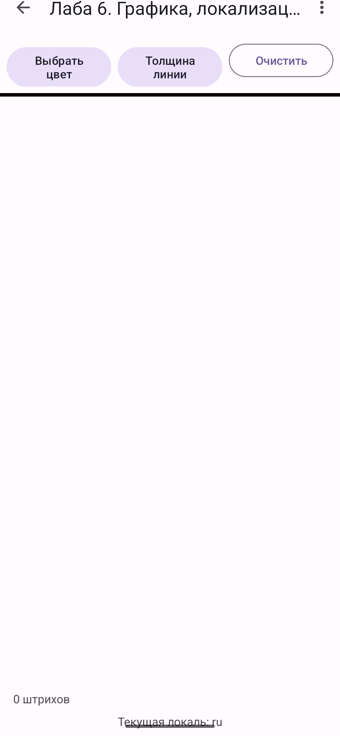
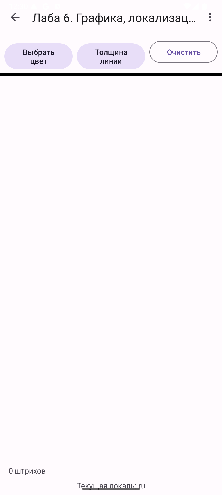
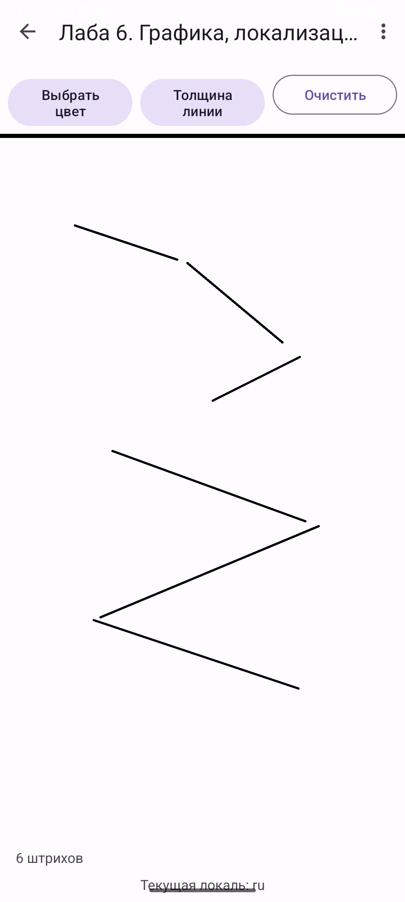
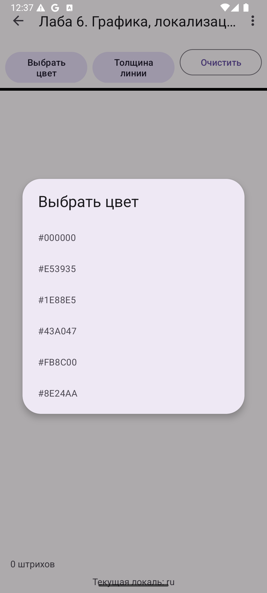
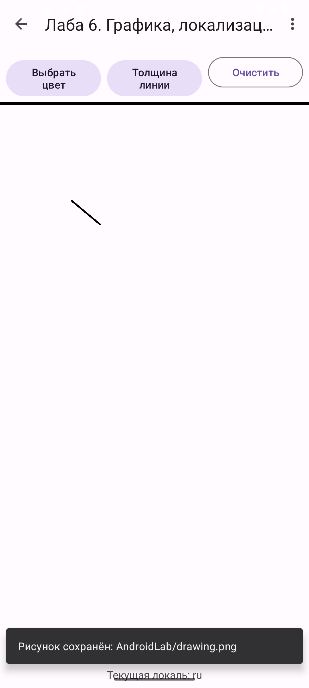
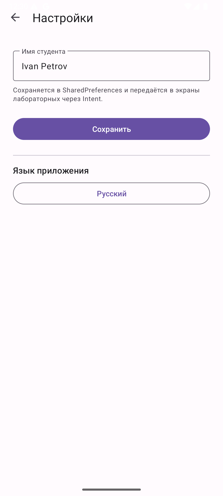
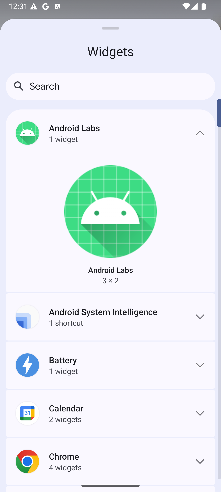
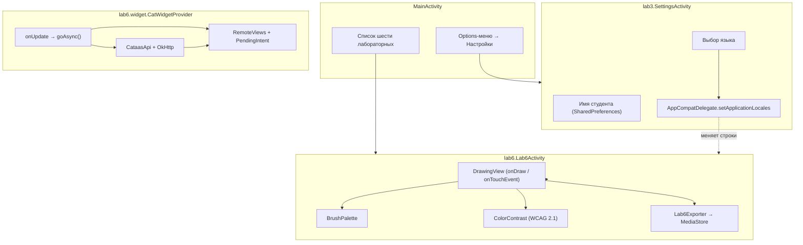

# Лабораторная 6. Графика, локализация, виджет

> **Сложность:** выше средней · **Время:** 4–5 часов · **Тег:** `lab6-v1.0`
> **Итог:** три независимые темы в одной работе — рисование пальцем на `Canvas`,
> переключение языка приложения на ходу и виджет рабочего стола с картинкой кота.



---

## 🎯 Цель работы

> Освоить три темы, которые обычно остаются «на потом»: собственную отрисовку
> через `Canvas`, прикладную локализацию (`values-en` / `values-de` и
> `setApplicationLocales`) и вывод виджета на рабочий стол через
> `AppWidgetProvider` и `RemoteViews`.

| | |
|---|---|
| **Что делаем** | Экран «Графика, локализация, виджет»: холст для рисования с палитрой и толщиной, переключатель языка в настройках, виджет «Котёнок дня» |
| **Чему учимся** | `onDraw` / `onTouchEvent` / `Path`, `Bitmap` и экспорт рисунка, `values-<lang>`, `AppCompatDelegate.setApplicationLocales`, `AppWidgetProvider`, `RemoteViews`, `PendingIntent`, `goAsync` |
| **Итоговый навык** | Понимать, чем кастомный `View` отличается от разметки, как не хардкодить строки и почему обновление виджета нельзя делать в главном потоке |

## 📚 Что изучим

- `View.onDraw` и `Canvas`: `drawPath`, `Paint` (цвет, толщина, `strokeCap`, `strokeJoin`)
- `MotionEvent`: `ACTION_DOWN` / `MOVE` / `UP` и хранение линии как `Path`
- Почему нельзя рисовать прямо в `onTouchEvent` — только `invalidate()` и перерисовка в `onDraw`
- Снимок холста в `Bitmap` и сохранение в «Загрузки» через `MediaStore`
- Контраст текста по WCAG 2.1 (`luminance`, `contrast`) и зачем это вообще
- Квалификаторы ресурсов: `values`, `values-en`, `values-de`, `values-night`
- `AppCompatDelegate.setApplicationLocales` и `AppLocalesMetadataHolderService`
- `AppWidgetProvider`: `onUpdate` против `onReceive`, ограничение в 30 минут
- `RemoteViews`: почему в виджете нет обычных `View` и `setOnClickListener`
- `PendingIntent` для кнопки виджета и `goAsync()` для фоновой загрузки

---

## 🖼️ Что получится


| Экран | Скриншот |
|-------|----------|
| Холст для рисования |  |
| Штрихи и счётчик |  |
| Выбор цвета |  |
| Экспорт рисунка |  |
| Переключатель языка в настройках |  |
| Виджет в панели выбора |  |

---

## 🧠 Архитектура



---

## 📖 Теория (кратко)

### 6.1 Кастомный `View`: `onDraw` и `onTouchEvent`

Обычные экраны собираются из готовых `View` в разметке. Рисование пальцем так не
опишешь, поэтому нужен свой `View`. Ключевое правило: **данные и отрисовка
разделены**. `onTouchEvent` только накапливает штрихи (список `Path`) и вызывает
`invalidate()`; сама картинка появляется в `onDraw`. Если рисовать в
`onTouchEvent`, система перерисует экран в случайный момент и часть штрихов
пропадёт.

### 6.2 Почему `Path`, а не точки

Хранить каждую точку по отдельности — это тысячи объектов на одну линию.
`Path` копит ломаную внутри себя, а `Paint` описывает стиль: цвет, толщину,
`strokeCap = ROUND` (круглые концы) и `strokeJoin = ROUND`. При отпускании пальца
текущий `Path` копируется в список штрихов, чтобы его цвет и толщина не менялись
задним числом вместе с настройками.

### 6.3 Контраст текста (WCAG 2.1)

Белый текст на жёлтом читается плохо, чёрный — отлично, и наоборот. Android сам
текст под фон не перекрашивает. Поэтому считаем относительную яркость канала
(с гамма-развёрткой) и отношение контраста:

```
contrast = (lighter + 0.05) / (darker + 0.05)     // 1.0 … 21.0
```

Белое на чёрном даёт ровно 21.0 — и это первое место, где вылезает погрешность
`Float`.

### 6.4 Локализация: квалификаторы и `setApplicationLocales`

Android выбирает строку по локали устройства: нет `values-de` — возьмёт
`values` (по умолчанию). Чтобы **дать пользователю** выбрать язык внутри
приложения (а не заставлять менять системный), нужен
`AppCompatDelegate.setApplicationLocales`. Он работает на всех версиях через
AppCompat, но результат сохраняется между запусками только если в манифесте есть
`AppLocalesMetadataHolderService` с `autoStoreLocales = true`.

### 6.5 Виджет: `AppWidgetProvider` и `RemoteViews`

Виджет рисует **не ваше приложение**, а лаунчер. Поэтому вместо `View` вы
отдаёте `RemoteViews` — «чертёж», по которому чужой процесс соберёт интерфейс.
Отсюда ограничения: только разрешённые классы `View`, никаких `findViewById`,
только `setTextViewText` / `setImageViewBitmap` и т.п.

`onUpdate` приходит в главном потоке, а сеть в главном потоке — это
`NetworkOnMainThreadException`. Плюс на обработку широковещания система даёт
около 10 секунд. Решение — `goAsync()` (продлевает приём) и корутина на
`Dispatchers.IO`, которая обновляет виджет и зовёт `finish()`.

---

## 🛠️ Пошаговая реализация

### Шаг 1. Палитра и контраст

**Зачем:** цвет — это данные, а не ресурс: линии рисуются в `Canvas` напрямую.

```kotlin
object BrushPalette {
    val COLORS = listOf(
        Color.BLACK, Color.parseColor("#E53935"), Color.parseColor("#1E88E5"),
        Color.parseColor("#43A047"), Color.parseColor("#FB8C00"), Color.parseColor("#8E24AA"),
    )
    val WIDTHS = listOf(2f, 6f, 12f, 20f)
    val DEFAULT_COLOR = COLORS.first()
    val DEFAULT_WIDTH = WIDTHS[1]
}
```

`ColorContrast` считает яркость и контраст. Промежуточные вычисления — в
`Double`, в `Float` переводится только результат.

**Результат:** `ColorContrastTest` — 6 зелёных тестов.

### Шаг 2. `DrawingView`

**Зачем:** показать, как `View` хранит состояние и реагирует на касания.

```kotlin
override fun onDraw(canvas: Canvas) {
    super.onDraw(canvas)
    strokes.forEach { canvas.drawPath(it.path, it.paint) }
    canvas.drawPath(currentPath, currentPaint)
}
```

При `ACTION_UP` штрих копируется в список, и вызывается `onStrokesChanged`, чтобы
экран обновил счётчик.

### Шаг 3. Экран рисования

`Lab6Activity` подключает палитру, толщину, «Очистить» и меню «Экспорт рисунка».
Кнопки цвета/толщины открывают `MaterialAlertDialogBuilder` со списком значений.

**Результат:** `6 штрихов` в счётчике, красный цвет — красная линия.

### Шаг 4. Экспорт рисунка

`DrawingView.render()` рисует штрихи на отдельном `Bitmap` с непрозрачным фоном,
`Lab6Exporter` сохраняет PNG в «Загрузки» через `MediaStore` (как в Лабе 4, но из
`Bitmap`, а не из `File`).

**Результат:** `Рисунок сохранён: AndroidLab/drawing.png`, файл физически в
`/sdcard/Download/AndroidLab/`.

### Шаг 5. Локализация

Строки Лабы 6 вынесены в `strings.xml`, добавлены `values-en/strings.xml` и
`values-de/strings.xml`. В `SettingsActivity` — переключатель языка:

```kotlin
private fun applyLanguage(tag: String?) {
    val locales = if (tag == null) LocaleListCompat.getEmptyLocaleList()
                  else LocaleListCompat.forLanguageTags(tag)
    AppCompatDelegate.setApplicationLocales(locales)
    recreate()
}
```

В манифесте — сервис для сохранения выбора:

```xml
<service android:name="androidx.appcompat.app.AppLocalesMetadataHolderService"
    android:enabled="false" android:exported="false">
    <meta-data android:name="autoStoreLocales" android:value="true" />
</service>
```

**Результат:** язык переключается без перезапуска приложения; `ru`, `en`, `de`.

### Шаг 6. Виджет «Котёнок дня»

`res/layout/widget_cat.xml` (только разрешённые `View`), `res/xml/widget_info.xml`
(`updatePeriodMillis = 1800000` — минимум 30 минут) и регистрация в манифесте:

```xml
<receiver android:name=".lab6.widget.CatWidgetProvider" android:exported="false">
    <intent-filter>
        <action android:name="android.appwidget.action.APPWIDGET_UPDATE" />
    </intent-filter>
    <meta-data android:name="android.appwidget.provider"
        android:resource="@xml/widget_info" />
</receiver>
```

Загрузка картинки — в корутине с `goAsync()`:

```kotlin
private fun refreshCats(context: Context) {
    val pendingResult = goAsync()
    val scope = CoroutineScope(SupervisorJob() + Dispatchers.IO)
    scope.launch {
        try {
            val bitmap = loadRandomCatImage()          // CataasApi + OkHttp
            updateAll(context, bitmap, null)
        } catch (e: Exception) {
            updateAll(context, null, e.message)
        } finally {
            pendingResult.finish()
            scope.cancel()
        }
    }
}
```

Кнопка «Обновить кота» — это `PendingIntent.getBroadcast` на своё внутреннее
действие `ACTION_REFRESH`.

**Результат:** виджет виден в панели выбора («Android Labs — 1 widget»,
превью 3×2).

---

## 🐛 Что пошло не так (грабли)

### Грабли 1. `<plurals>` превратили в `<string>` — и сборка встала

Во время «наведения порядка» в строках `lab2_cats_count` оказался обычным
`<string>`, а код обращался к `R.plurals.lab2_cats_count`:

```
e: Lab2Activity.kt:154:47 Unresolved reference 'lab2_cats_count'
```

Компилятор не различает «нет ресурса» и «ресурс не того типа» — сообщение одно и
то же. **Решение:** вернуть `<plurals>` туда, где его ждёт код, и не разносить
ресурсы по случайным файлам. Ресурс — это контракт с кодом, а не текст.

### Грабли 2. Контраст чёрного на белом «не дотягивал» до 21

Тест требовал `c > 20f && c <= 21f`, а математика давала `20.999…`:
каналы округлялись до `Float` **до** возведения в степень. **Решение:** все
промежуточные вычисления вести в `Double`, в `Float` переводить только результат.
Убирает и «особые случаи для WHITE/BLACK», которые до этого костылём прятали
погрешность.

### Грабли 3. Забыли зарегистрировать `Lab6Activity` в манифесте

`LabCatalog` уже ссылался на `Lab6Activity`, а в `AndroidManifest.xml` её не
было. Приложение падало бы с `ActivityNotFoundException` при первом же тапе по
пункту 6. **Решение:** каждую `Activity` — в манифест, сразу вместе с классом.

### Грабли 4. `setApplicationLocales` не переживал перезапуск

Язык менялся, но после убийства процесса возвращался системный. Причина — нет
`AppLocalesMetadataHolderService` с `autoStoreLocales`. **Решение:** объявить
сервис в манифесте (см. Шаг 5).

### Грабли 5. Хардкод «Загрузки» внутри экспортёра

Метка успеха собиралась как `"Загрузки/$EXPORT_DIR/$fileName"` прямо в коде
экспортёра. В английской локали это выглядело как баг: интерфейс английский, а
путь русский. **Решение:** экспортёр возвращает нейтральный относительный путь
(`AndroidLab/drawing.png`), а слово «Загрузки/Downloads» добавляет ресурс на
экране, если нужно.

### Грабли 6. Shell не может разбудить non-exported receiver

Проверяя виджет, я слал `am broadcast … -n …/CatWidgetProvider` и получал
`Broadcast completed: result=0`, но приложение не просыпалось. Это не ошибка
кода: `exported="false"` (а для виджета это правильно) закрывает рассылку извне.
**Вывод:** вести проверку виджета нужно через лаунчер, а не через `adb shell
am broadcast`.

### Грабли 7. Координаты тапов «съезжают» при смене языка

После переключения на русский заголовки стали длиннее, часть строк перенеслась
на две строки, и тап по захардкоженной координате попал в соседнюю лабораторную.
**Решение:** брать координаты из `uiautomator dump` (по `bounds` нужного текста),
а не запоминать на глаз.

---

## 🤔 Разбор решений

- **Почему данные палитры в `BrushPalette`, а не в разметке?** Потому что цвет
  линии не элемент темы: это параметр рисования. Тема может стать тёмной —
  бумага и краски остаются прежними.
- **Почему фон холста — отдельный `drawing_background`, а не `?attr/colorSurface`?**
  В тёмной теме `colorSurface` почти чёрный, и чёрная линия на нём не видна.
  Бумага должна оставаться светлой.
- **Почему `render()` рисует на новом `Bitmap`, а не `view.draw()`?** `view.draw()`
  захватывает всё, что сейчас на экране (с учётом системных вставок), а нам нужен
  именно холст; заодно мы задаём непрозрачный фон, иначе PNG прозрачный.
- **Почему язык меняется через `AppCompatDelegate`, а не через свой `ContextWrapper`?**
  `ContextWrapper` нужно прокидывать в каждую `Activity`, он не переживает
  перезапуск и конфликтует с системой. `AppCompatDelegate` — штатный путь.
- **Почему виджет грузит картинку по кнопке, а не только раз в 30 минут?**
  `updatePeriodMillis` не может быть меньше 30 минут (ограничение системы).
  Для «сейчас» нужна явная рассылка через `PendingIntent`.

---

## ✅ Чек-лист сдачи

- [x] Рисование пальцем: цвет, толщина, «Очистить», счётчик штрихов
- [x] `ColorContrast` по WCAG 2.1, 6 unit-тестов зелёные
- [x] Экспорт рисунка в «Загрузки» через `MediaStore`
- [x] `values-en` и `values-de` с полным набором строк
- [x] Переключатель языка в настройках через `setApplicationLocales`
- [x] Выбор языка переживает перезапуск (`autoStoreLocales`)
- [x] Виджет `CatWidgetProvider` + `widget_cat.xml` + `widget_info.xml`
- [x] Виджет зарегистрирован в манифесте и виден в панели выбора
- [x] Кнопка «Обновить кота» через `PendingIntent`
- [x] Загрузка картинки вне главного потока (`goAsync` + корутина)
- [x] `Lab6Activity` зарегистрирована в манифесте
- [x] Сборка `assembleDebug` и все unit-тесты зелёные
- [x] Документация, скриншоты и GIF

---

## 🔗 Полезные ссылки

- [Canvas and Drawables](https://developer.android.com/develop/ui/views/graphics/drawables)
- [Custom View components](https://developer.android.com/develop/ui/views/layout/custom-views/create-view)
- [Per-app language preferences](https://developer.android.com/guide/topics/resources/app-languages)
- [App widgets overview](https://developer.android.com/develop/ui/views/appwidgets/overview)
- [RemoteViews](https://developer.android.com/reference/android/widget/RemoteViews)
- [WCAG 2.1: relative luminance / contrast ratio](https://www.w3.org/WAI/WCAG21/Understanding/contrast-minimum.html)
- [MediaStore](https://developer.android.com/training/data-storage/shared/media)

## 📌 Коммиты лабы

- `feat(lab6): холст, палитра и контраст по WCAG`
- `feat(lab6): локализация — values-en/values-de и переключатель языка`
- `feat(lab6): виджет «Котёнок дня» и регистрация в манифесте`
- `docs(lab6): документация, скриншоты и демонстрационный GIF`
